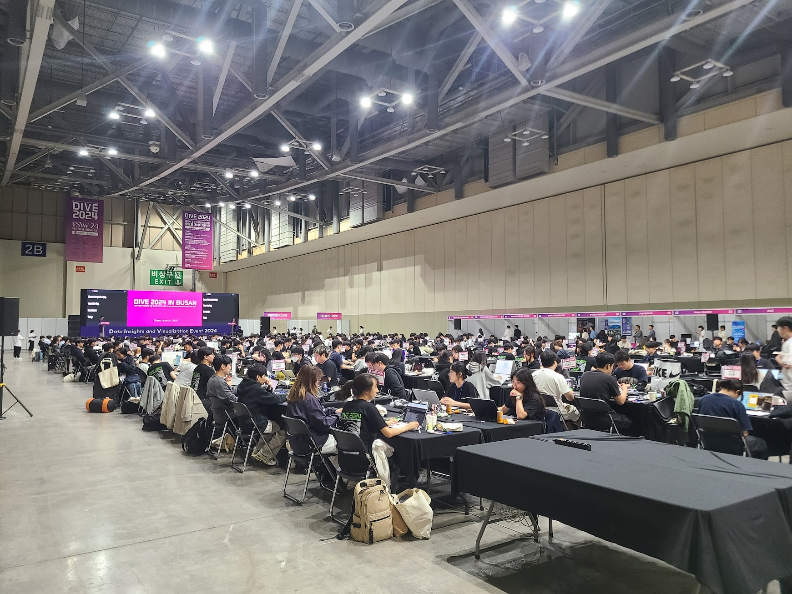
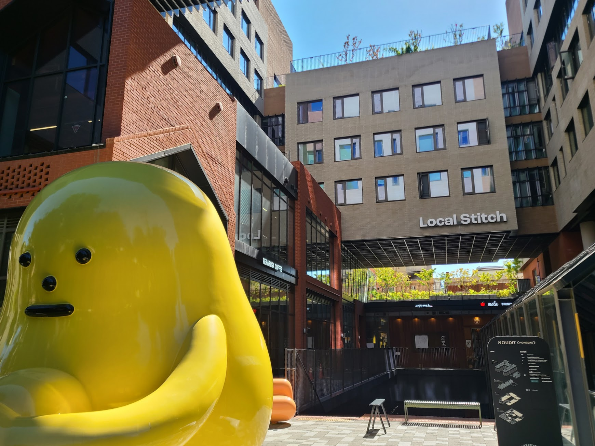
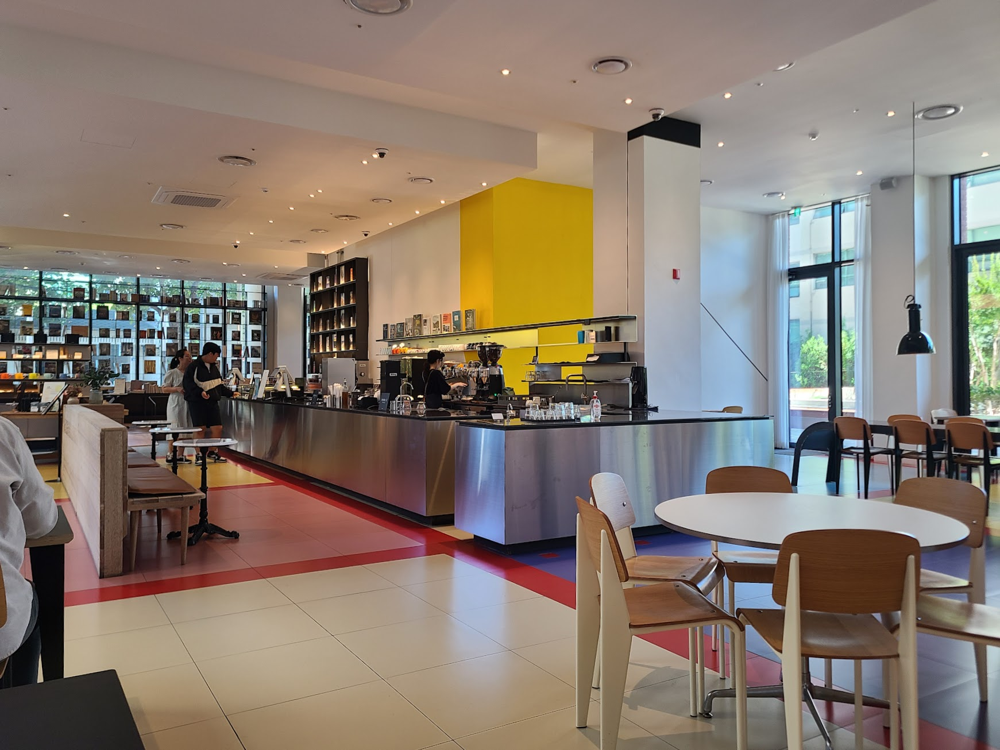
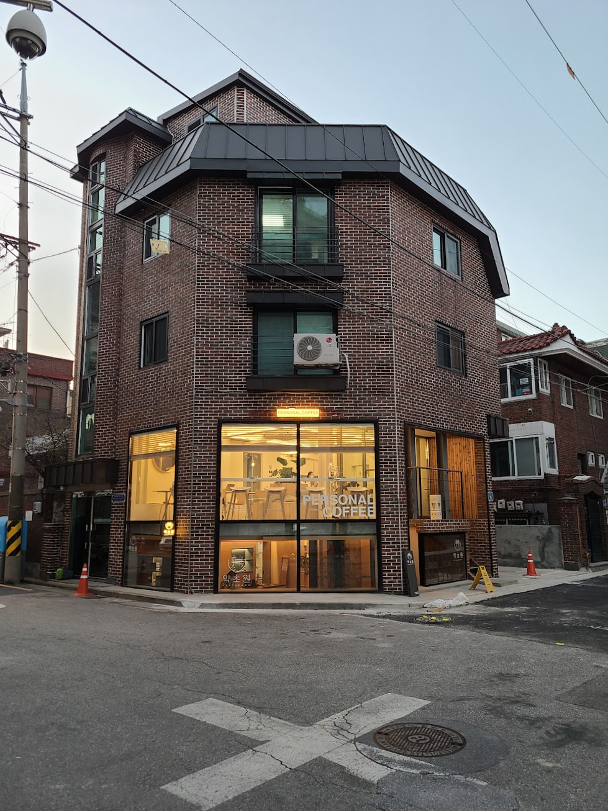
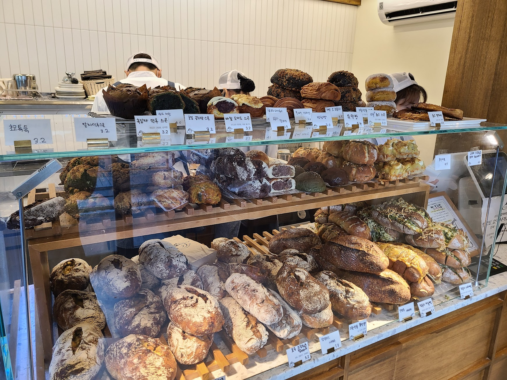
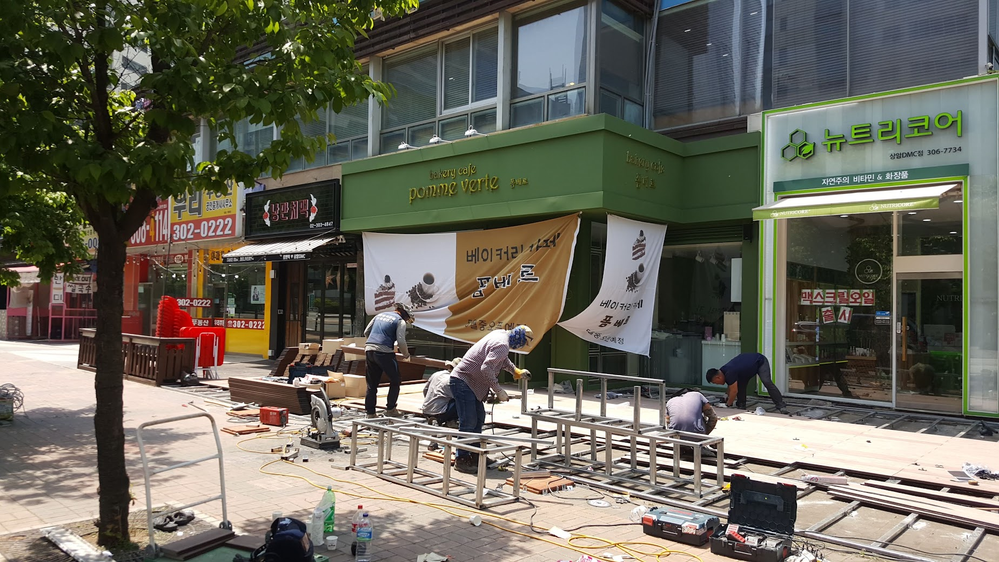
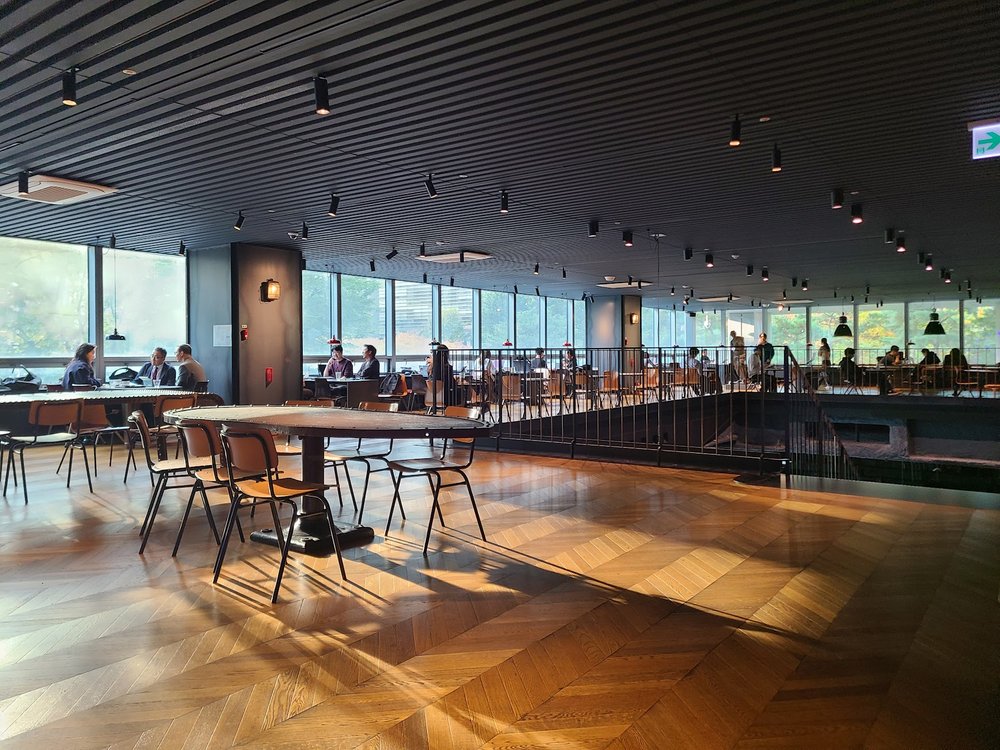
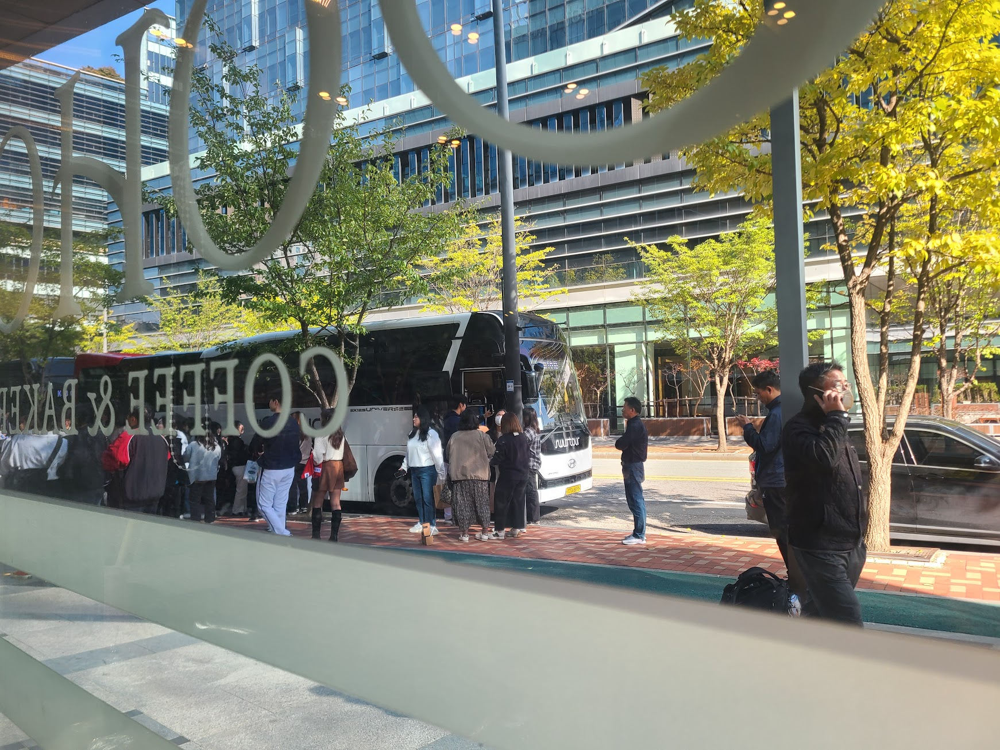

## 문제 1

Q: 다음 이미지에 대한 설명 중 옳지 않은 것은 무엇인가요?
- (1) 많은 사람들이 테이블에 앉아 있습니다.
- (2) 'DIVE 2024 IN BUSAN'이라는 문구가 보입니다.
- (3) 사람들이 운동장에서 모여 있습니다.
- (4) 벽에 'EXIT' 표시가 보입니다.

정답: (3) 사람들이 운동장이 아닌 실내 공간에서 모여 있습니다.

---------------------

## 문제 2

Q: 다음 이미지에 대한 설명 중 옳지 않은 것은 무엇인가요?
- (1) 건물 외벽에 "Local Stitch"라는 글자가 보입니다.
- (2) 노란색 조형물이 있는 모습을 볼 수 있습니다.
- (3) 건물 외벽은 대부분 회색으로 되어 있습니다.
- (4) 이미지에 보이는 건물은 모두 유리로 이루어져 있습니다.

정답: (4) 이미지에 보이는 건물은 모두 유리로 이루어져 있는 것이 아닙니다. 건물은 벽돌 등 다른 재질로도 되어 있습니다.

---------------------

## 문제 3

Q: 다음 이미지에 대한 설명 중 옳지 않은 것은 무엇인가요?

- (1) 카페의 카운터 위에 노란색 배경이 있습니다.
- (2) 왼쪽에는 사람들이 앉아 있는 테이블이 보입니다.
- (3) 카운터 뒤에 있는 사람은 검은색 옷을 입고 있습니다.
- (4) 창문 밖으로 자전거가 보입니다.

정답: (4) 창문 밖으로 자전거가 보이지 않습니다.

---------------------

## 문제 4

Q: 다음 이미지에 대한 설명 중 옳지 않은 것은 무엇인가요?
- (1) 건물의 벽돌 외관이 보입니다.
- (2) 건물의 2층에 커피숍이 있습니다.
- (3) 건물 앞 도로에 주황색 원뿔이 놓여져 있습니다.
- (4) 'PERSONAL COFFEE'라는 글자가 창문에 있습니다.

정답: (2) 건물의 2층이 아닌 1층에 커피숍이 있습니다.

---------------------

## 문제 5

    Q: 다음 이미지에 대한 설명 중 옳지 않은 것은 무엇인가요?

    - (1) 유리 진열대에 여러 종류의 빵이 놓여 있습니다.
    - (2) 진열대 위쪽에 붙어 있는 빵의 가격은 3.2입니다.
    - (3) 점원이 이상한 모양의 모자를 쓰고 있습니다.
    - (4) 진열된 빵 중 일부는 초콜릿으로 덮여 있습니다.

    정답: (3) 점원은 이상한 모양의 모자를 쓰지 않았습니다.

---------------------

## 문제 6

Q: 다음 이미지에 대한 설명 중 옳지 않은 것은 무엇인가요?
- (1) 사람들이 공사 작업을 하고 있는 모습이 보입니다.
- (2) "베이커리 카페"라는 글자가 쓰인 간판이 있습니다.
- (3) 그린 계열의 간판이 보입니다.
- (4) "뉴트리코어" 가게 앞에서 사람들이 줄을 서 있습니다.

정답: (4) "뉴트리코어" 가게 앞에서 사람들이 줄을 서 있는 모습이 아닌 공사하고 있는 모습입니다.

---------------------

## 문제 7

Q: 다음 이미지에 대한 설명 중 옳지 않은 것은 무엇인가요?

- (1) 창밖으로 자연 경관이 보입니다.
- (2) 실내에는 여러 사람이 앉아 있습니다.
- (3) 바닥이 파란색 카펫으로 덮여 있습니다.
- (4) 천장에는 조명이 설치되어 있습니다.

정답: (3) 바닥이 파란색 카펫으로 덮여 있는 것이 아니라 나무 마루로 되어 있습니다.

---------------------

## 문제 8

Q: 다음 이미지에 대한 설명 중 옳지 않은 것은 무엇인가요?
- (1) 많은 사람들이 버스에 타기 위해 줄을 서 있습니다.
- (2) 사진은 건물 내부에서 촬영되었습니다.
- (3) 건너편에 나무가 심어진 보도블록이 있습니다.
- (4) 사람들 중에는 빨간색 셔츠를 입은 사람이 있습니다.
    
정답: (4) 사람들 중에는 빨간색 셔츠를 입은 사람이 없습니다.

---------------------

