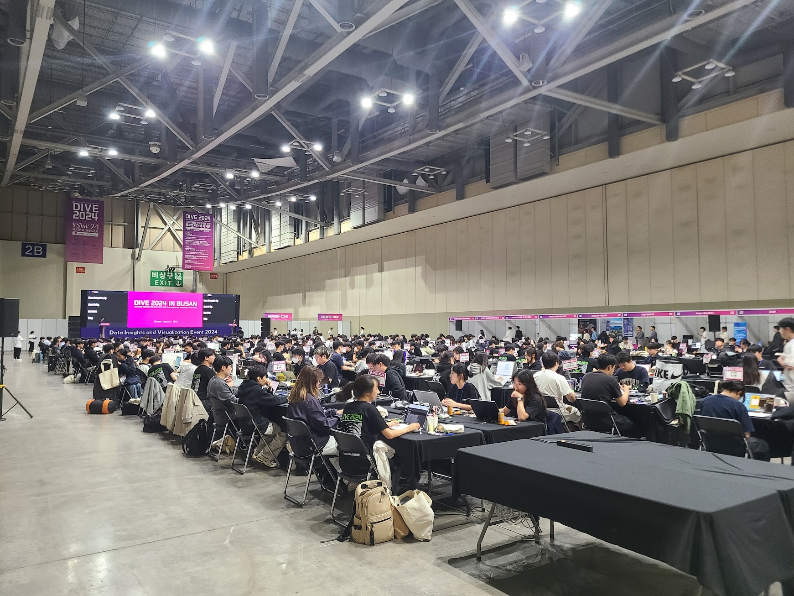
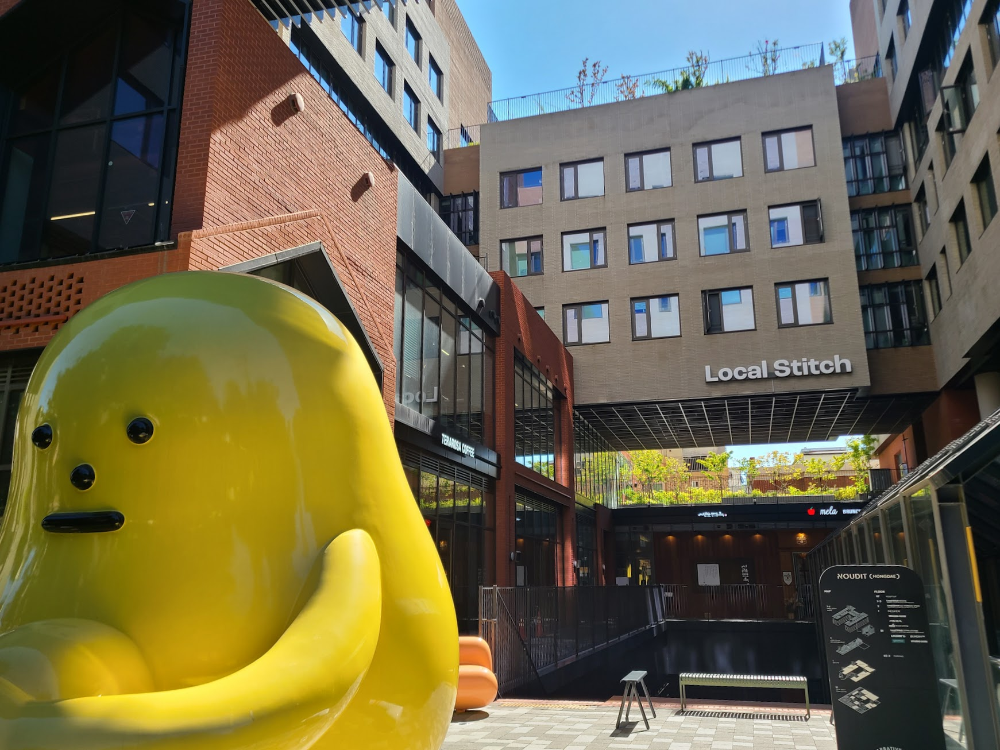
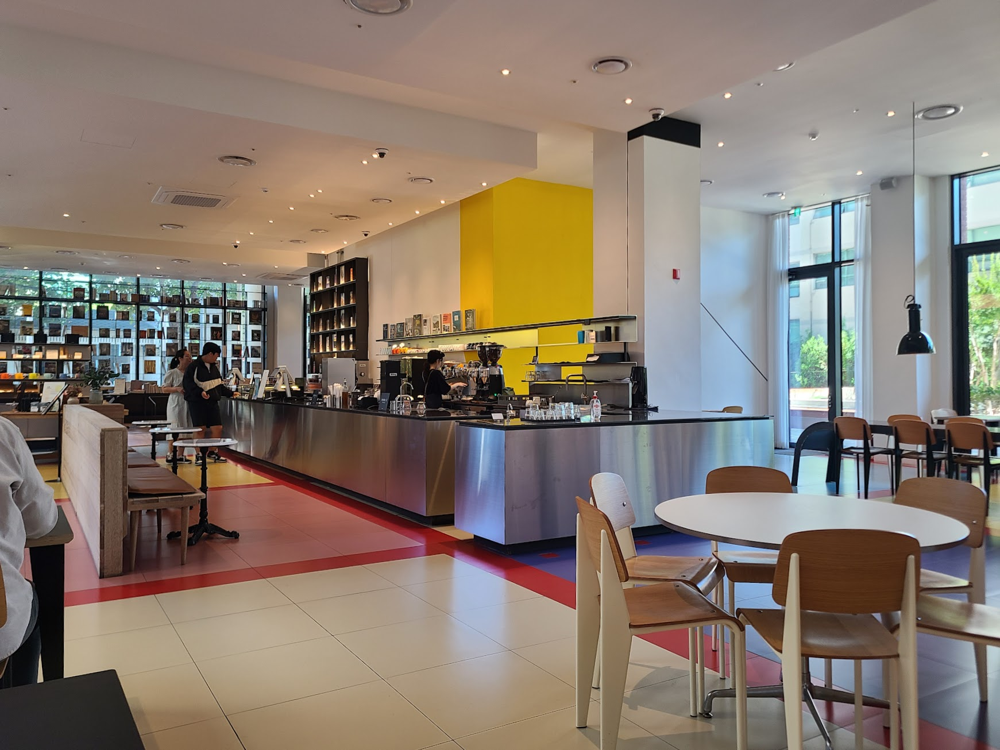
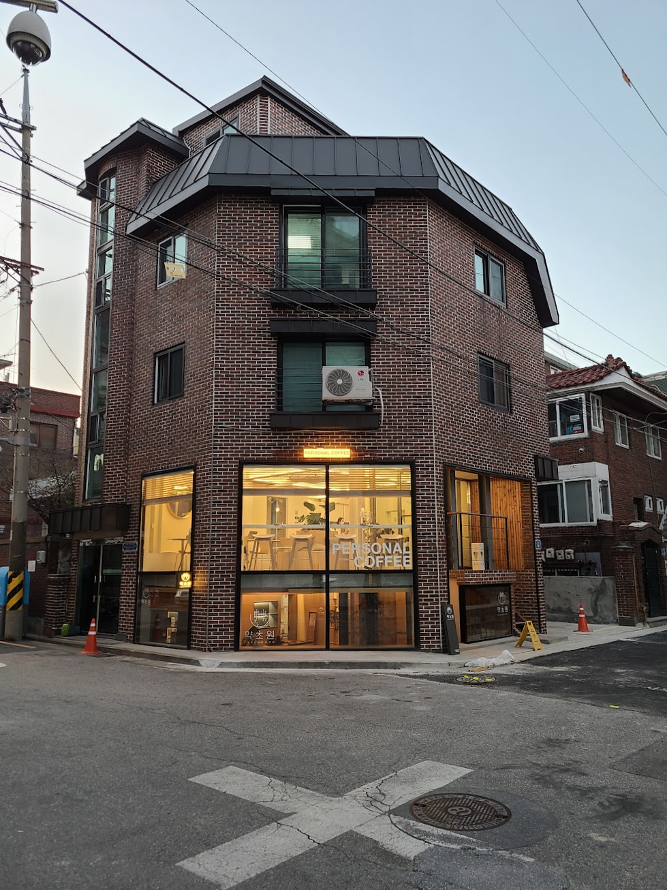
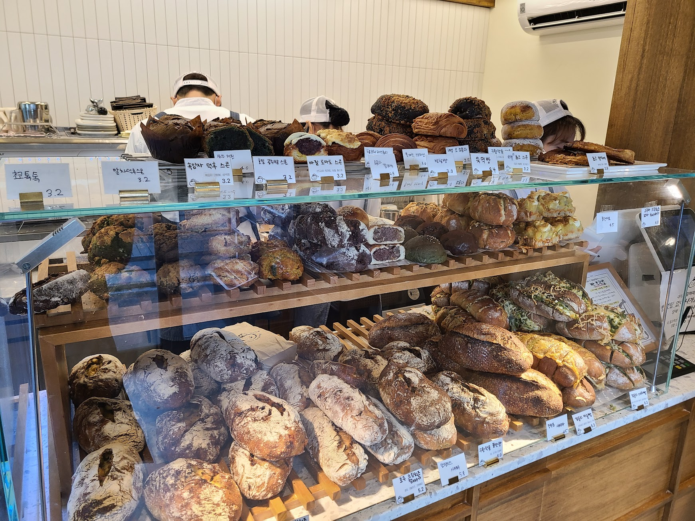
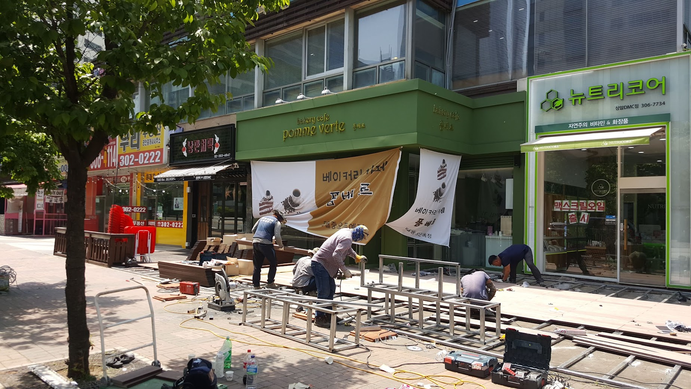
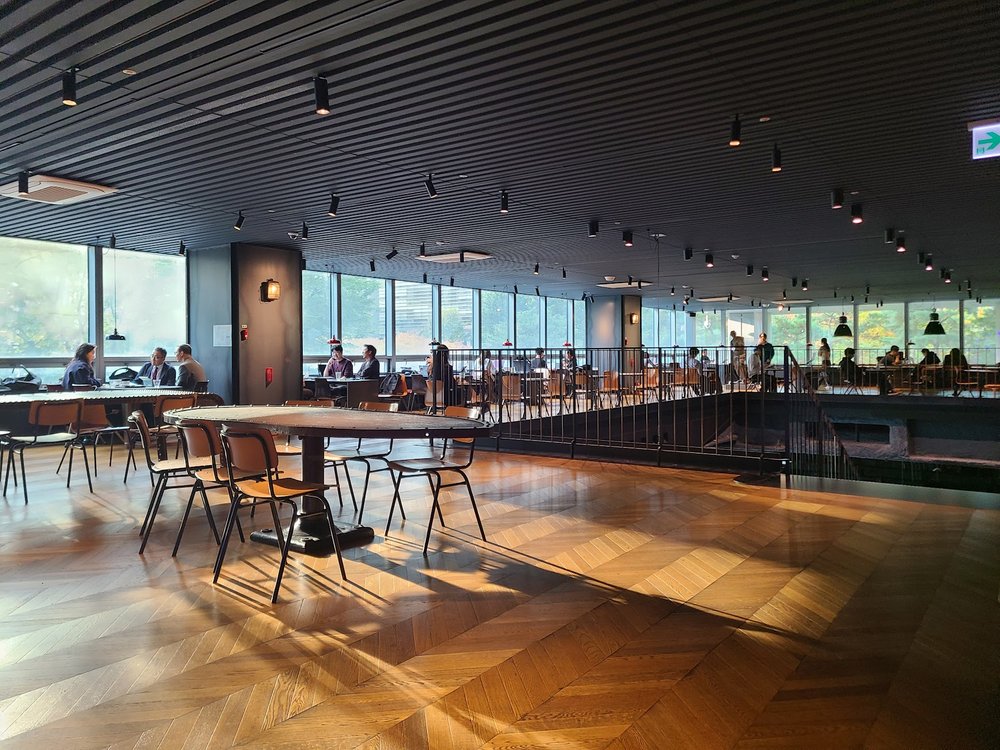
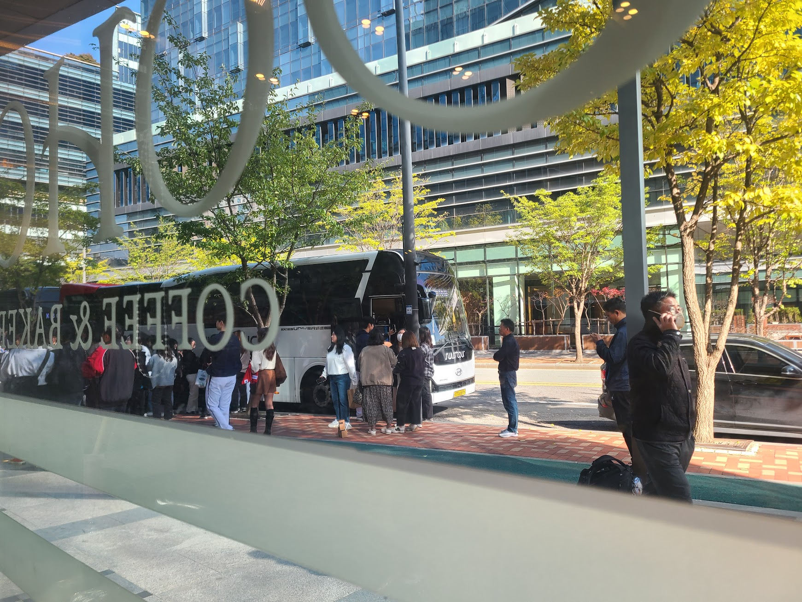

## 문제 1

Q: 다음 이미지에 대한 설명 중 옳지 않은 것은 무엇인가요?
- (1) 많은 사람들이 큰 실내 공간에서 컴퓨터 앞에 앉아 있습니다.
- (2) 행사장에 'DIVE 2024 IN BUSAN'이라는 문구가 보입니다.
- (3) 사람들이 영화 촬영을 하고 있는 모습입니다.
- (4) 천장에는 여러 개의 조명이 설치되어 있습니다.

Listening: Which of the following descriptions of the image is incorrect?
- (1) Many people are sitting in a large indoor space in front of computers.
- (2) The phrase 'DIVE 2024 IN BUSAN' is visible at the venue.
- (3) It shows people filming a movie.
- (4) There are several lights installed on the ceiling.

정답: (3) 사람들은 영화 촬영을 하고 있는 것이 아니라, 컴퓨터 앞에 앉아 작업 중입니다.

---------------------

## 문제 2

Q: 다음 이미지에 대한 설명 중 옳지 않은 것은 무엇인가요?
- (1) 노란색 조형물이 건물 앞에 있습니다.
- (2) 건물 상단에는 "Local Stitch"라는 글자가 보입니다.
- (3) 조형물 앞에 사람들이 앉아 있습니다.
- (4) 건물은 붉은색과 회색으로 이루어져 있습니다.

Listening: Which of the following descriptions of the image is incorrect?
- (1) There is a yellow sculpture in front of the building.
- (2) The top of the building displays the words "Local Stitch."
- (3) There are people sitting in front of the sculpture.
- (4) The building is composed of red and gray colors.

정답: (3) 조형물 앞에 사람들이 앉아 있지 않습니다.

---------------------

## 문제 3

Q: 다음 이미지에 대한 설명 중 옳지 않은 것은 무엇인가요?
- (1) 카페의 내부 모습이 담겨 있습니다.
- (2) 카운터 뒤에 노란색 배경이 보입니다.
- (3) 카운터에 세 명의 점원이 서 있습니다.
- (4) 손님들이 주문을 하고 있는 장면입니다.

Listening: Which of the following descriptions of the image is incorrect?
- (1) It shows the interior of a cafe.
- (2) There is a yellow background behind the counter.
- (3) There are three staff members standing at the counter.
- (4) Customers are placing orders.

정답: (3) 카운터에 두 명의 점원이 서 있습니다.

---------------------

## 문제 4

Q: 다음 이미지에 대한 설명 중 옳지 않은 것은 무엇인가요?
- (1) 건물 외벽은 벽돌로 되어 있습니다.
- (2) "PERSONAL COFFEE"라는 문구가 유리창에 적혀 있습니다.
- (3) 건물 앞 도로에는 공사 표지판이 서 있습니다.
- (4) 건물 옥상에 태양광 패널이 설치되어 있습니다.

Listening: Which of the following descriptions of the image is incorrect?
- (1) The exterior of the building is made of brick.
- (2) There is a "PERSONAL COFFEE" sign on the window.
- (3) There is a construction sign on the road in front of the building.
- (4) Solar panels are installed on the roof of the building.

정답: (4) 건물 옥상에 태양광 패널은 설치되어 있지 않습니다.

---------------------

## 문제 5

Q: 다음 이미지에 대한 설명 중 옳지 않은 것은 무엇인가요?
- (1) 진열대 위에는 다양한 종류의 빵이 보여지고 있습니다.
- (2) 점원이 빵을 정리하고 있는 모습이 보입니다.
- (3) 빵 가격표가 유리에 붙어 있습니다.
- (4) 사람들이 빵을 고르고 있는 모습이 보입니다.

Listening: Which of the following descriptions of the image is incorrect?
- (1) Various types of bread are displayed on the shelf.
- (2) A clerk is seen arranging the bread.
- (3) Bread price tags are attached to the glass.
- (4) People are seen choosing bread.

정답: (4) 사람들은 보이지 않고, 진열된 빵만 보입니다.

---------------------

## 문제 6

Q: 다음 이미지에 대한 설명 중 옳지 않은 것은 무엇인가요?
- (1) 사람들이 건물 앞에서 작업을 하고 있습니다.
- (2) 녹색 간판의 가게가 있습니다.
- (3) 나무가 그림의 왼쪽에 서 있습니다.
- (4) 사람들은 식당에서 식사를 하고 있습니다.

Listening: Which of the following descriptions of the image is incorrect?
- (1) People are working in front of a building.
- (2) There is a store with a green sign.
- (3) A tree is standing on the left side of the image.
- (4) People are dining at a restaurant.

정답: (4) 사람들은 식당에서 식사를 하고 있지 않습니다.

---------------------

## 문제 7

Q: 다음 이미지에 대한 설명 중 옳지 않은 것은 무엇인가요?
- (1) 사람들이 넓은 카페에서 대화를 나누고 있습니다.
- (2) 창문을 통해 실외의 나무가 보입니다.
- (3) 카페의 모든 테이블에 사람들이 앉아 있습니다.
- (4) 바닥은 나무 마루로 되어 있습니다.

Listening: Which of the following descriptions of the image is incorrect?
- (1) People are conversing in a spacious cafe.
- (2) Trees outside are visible through the windows.
- (3) All tables in the cafe have people sitting at them.
- (4) The floor is made of wooden planks.

정답: (3) 카페의 모든 테이블에 사람들이 앉아 있는 것은 아닙니다.

---------------------

## 문제 8

Q: 다음 이미지에 대한 설명 중 옳지 않은 것은 무엇인가요?
- (1) 사람들은 버스에 타기 위해 줄을 서 있습니다.
- (2) 이미지의 일부에 'COFFEE & BAKERY'라는 문구가 보입니다.
- (3) 나무들이 잎을 모두 떨어뜨린 상태입니다.
- (4) 한 남자가 핸드폰을 사용하고 있습니다.

Listening: Which of the following descriptions of the image is incorrect?
- (1) People are queuing to board a bus.
- (2) The phrase 'COFFEE & BAKERY' is visible in part of the image.
- (3) The trees have all shed their leaves.
- (4) A man is using a mobile phone.

정답: (3) 나무들이 잎을 모두 떨어뜨린 것이 아니라, 잎이 있습니다.

---------------------

